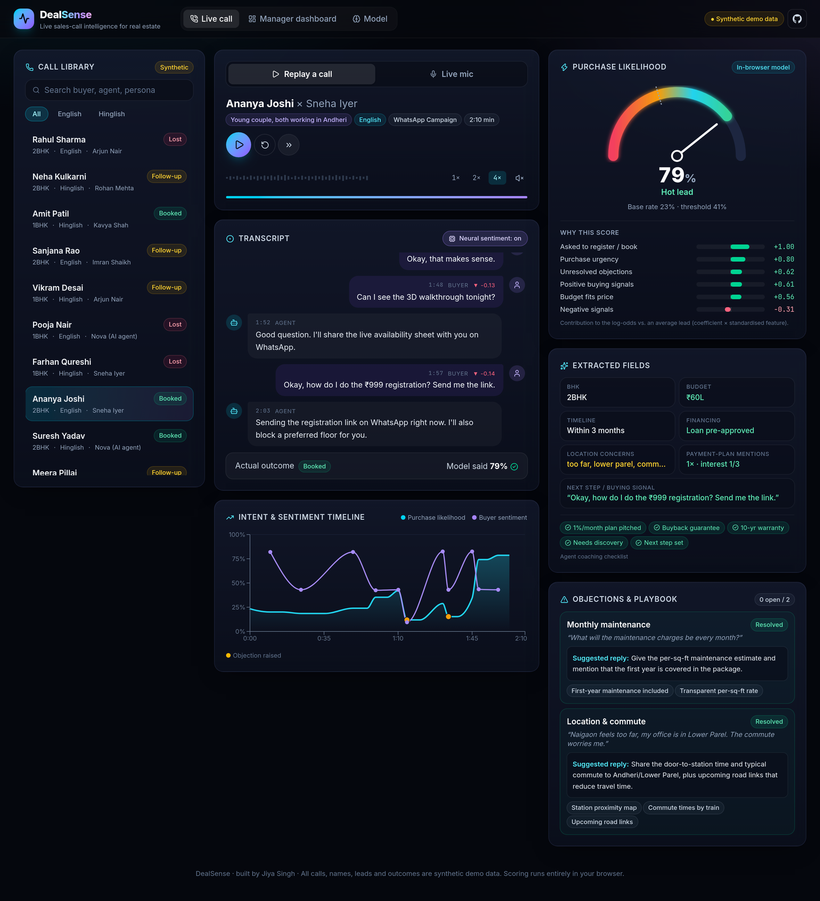
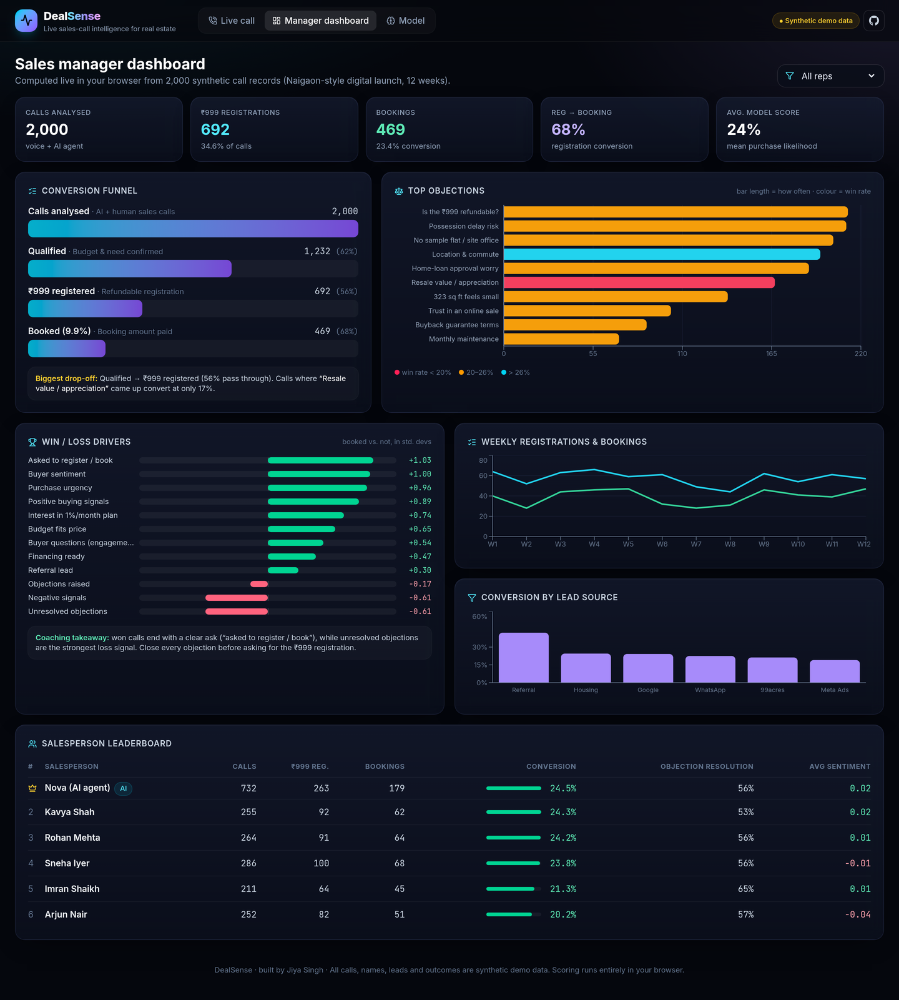
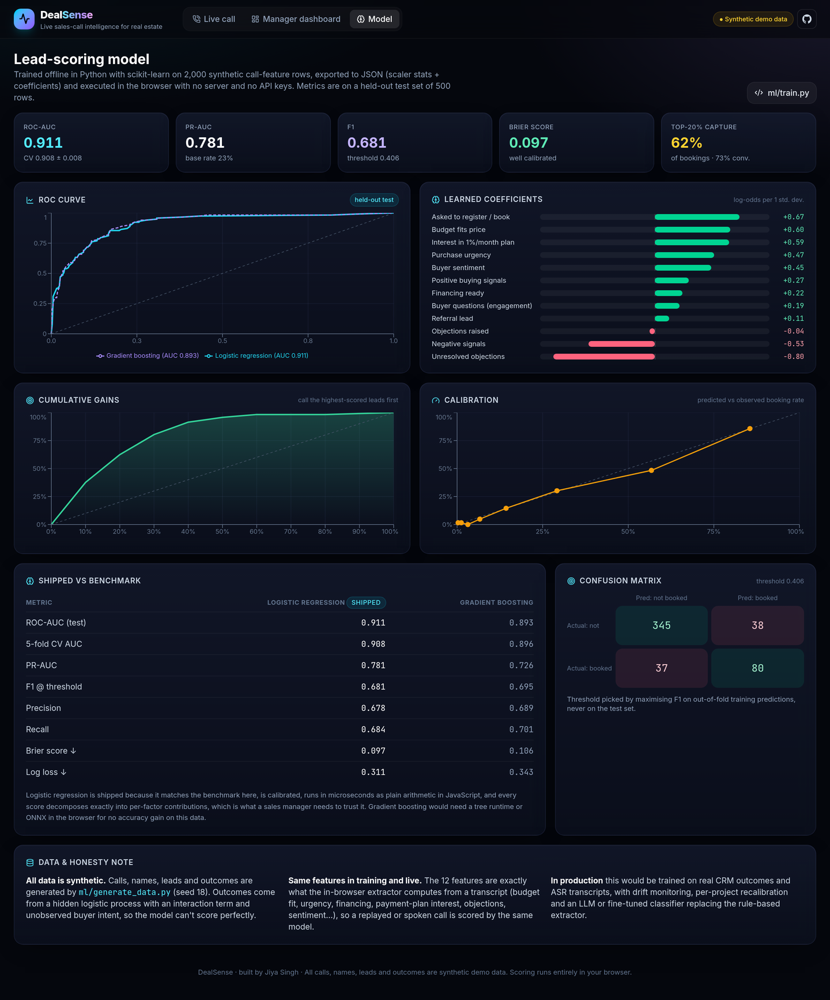
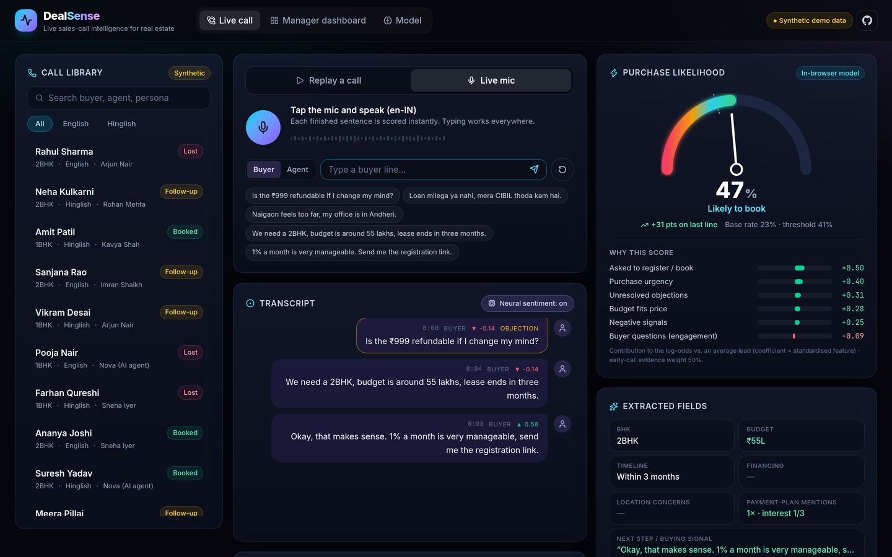

<div align="center">

# DealSense

**Live sales-call intelligence for real estate.**

Replay or speak a buyer–sales call and watch a purchase-likelihood score, intent and sentiment timeline, extracted buyer fields and objection playbook cards update line by line, all running **in your browser**.

[**Live demo →**](https://jiyasingh18.github.io/dealsense/) · [Model page](https://jiyasingh18.github.io/dealsense/#/model) · [Manager dashboard](https://jiyasingh18.github.io/dealsense/#/dashboard) · [Explainer](EXPLAINER.md)



</div>

> **All data is synthetic.** Every call, buyer, salesperson, lead and outcome is generated by `ml/generate_data.py` for demo purposes. The project/pricing context is modelled on a public, fully digital Naigaon-style launch (1BHK 323 sq ft from ₹34.99L, 2BHK from ₹52.99L, ₹999 refundable registration, 9.9% at booking, 10% after a month, then 1%/month until possession, 1-year buyback guarantee, 10-year structural warranty).

## What it does

| | |
|---|---|
| **Live call replay** | 28 timestamped synthetic calls (English + Hinglish) stream line by line with a typing/waveform animation and optional browser text-to-speech. |
| **Purchase-likelihood gauge** | A scikit-learn logistic-regression lead-scoring model, exported to JSON and executed in TypeScript, rescored after every line. |
| **"Why this score"** | Exact per-factor contributions (coefficient × standardised feature) showing what pushed the score up or down. |
| **Field extraction** | BHK, budget (and fit vs. price), timeline, financing readiness, location concerns, payment-plan mentions, next-step / buying signal. |
| **Objection playbook** | 10 objection types (₹999 refund, possession delay, no sample flat, loan approval, resale, commute, builder trust, carpet area, maintenance, buyback terms). Each is detected live, tracked open → resolved, and paired with a suggested reply and proof points. |
| **Live mic** | Web Speech API (`en-IN`, Chrome/Edge): speak a buyer line and it's scored instantly. Typed input and one-click examples work in every browser. |
| **Neural sentiment (optional)** | DistilBERT-SST2 via transformers.js (ONNX/WASM, on-device), lazily loaded from a CDN. The lexicon scorer is always the fallback, so the app never waits on a download. |
| **Manager dashboard** | Funnel, top objections with win rates, win/loss drivers, weekly trend, lead-source conversion and a salesperson leaderboard, all computed in the browser from 2,000 synthetic call records. |
| **Model page** | ROC (vs. gradient-boosting benchmark), coefficients, cumulative gains, calibration, confusion matrix, honesty notes. |

| Manager dashboard | Model |
|---|---|
|  |  |



## Model results (held-out test set, synthetic data)

| Metric | Logistic regression (shipped) | Gradient boosting (benchmark) |
|---|---|---|
| ROC-AUC | **0.911** | 0.893 |
| 5-fold CV AUC | 0.908 ± 0.008 | 0.896 ± 0.009 |
| PR-AUC | 0.781 | 0.726 |
| F1 @ 0.406 | 0.681 | 0.695 |
| Brier score | 0.097 | 0.106 |

Calling the top 20% of leads by score captures **62% of all bookings** (73% conversion vs. a 23% base rate).

## Architecture

```
ml/generate_data.py ──► ml/data/leads.csv (2,000 rows) ──► ml/train.py ──► src/data/model.json
        │                                                                    (scaler mean/scale, coefficients,
        └──► src/data/calls.json (28 transcripts)                             metrics, ROC/gains/calibration)
                                   │                                                  │
                                   ▼                                                  ▼
          Browser:  transcript line ─► nlp.ts (regex/lexicon extractor, EN + Hinglish) ─► 12 features
                                                                                         │
                         optional transformers.js sentiment ──► blended sentiment ───────┤
                                                                                         ▼
                                                     model.ts: sigmoid(intercept + Σ coef·z) + contributions
                                                                                         │
                                         gauge · timeline · fields · objection cards · dashboard
```

* **Fully static:** Vite + React 19 + TypeScript + Tailwind v4 + Recharts + Framer Motion. No server, no API keys, no secrets.
* **Same features in training and inference:** the 12 features the model was trained on are exactly what `src/lib/nlp.ts` extracts from a transcript.
* **Cold-start smoothing:** early in a call, count-based features are naturally zero, so the score is shrunk toward the base rate until the buyer has spoken ~6 times (exact sklearn output after that).

## Run locally

```bash
npm install
npm run dev            # http://localhost:5173/dealsense/

# retrain (optional)
python -m venv .venv && .venv/bin/pip install -r ml/requirements.txt
.venv/bin/python ml/generate_data.py && .venv/bin/python ml/train.py

npm run build          # static site in dist/
npm run deploy         # publish dist/ to the gh-pages branch
```

## Project layout

```
ml/                 data generator, training script, requirements
src/lib/            nlp.ts (extractor) · model.ts (inference) · playbook.ts · neural.ts · speech.ts
src/pages/          LiveCall · Dashboard · ModelPage
src/data/           calls.json · leads.json · model.json (generated)
deploy/             gh-pages publish script, optional GitHub Actions workflow
```

## Limitations

* Synthetic data: metrics show the pipeline works end to end, not real-world accuracy.
* The extractor is rule-based (fast, transparent, works offline). In production it would be replaced by an LLM or fine-tuned multilingual classifier on ASR transcripts.
* Live mic relies on the browser's Web Speech API (Chrome/Edge). Typed input works everywhere.

Built by [Jiya Singh](https://github.com/JiyaSingh18).
